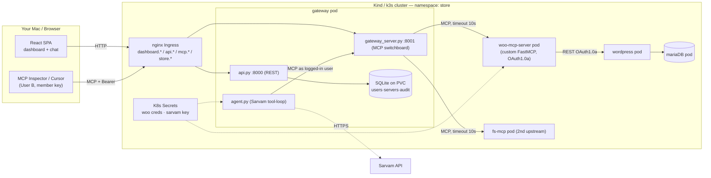

# Urumi MCP Platform

A Kubernetes-native, multi-user MCP (Model Context Protocol) gateway featuring a self-written WooCommerce MCP server, a React admin dashboard, and an AI chat agent powered by Sarvam AI. 

This platform allows AI agents and external MCP clients to securely interact with a WooCommerce store, manage upstream MCP servers, and maintain a strict audit trail of all tool executions.

---

## 🏗️ Architecture Overview

The system is composed of four main components running inside a Kubernetes cluster:

1. **The Store**: WordPress + WooCommerce + MariaDB (deployed via Bitnami Helm chart).
2. **Woo-MCP Server**: A self-written Python FastMCP server that translates MCP tool calls into WooCommerce REST API requests using OAuth 1.0a.
3. **Gateway Backend**: The core switchboard. It runs two services in one pod:
   - **MCP Endpoint (:8001)**: Aggregates tools from all registered upstream servers.
   - **REST API (:8000)**: Manages users, servers, and audit logs for the dashboard.
   - *Shared Storage*: A SQLite database on a Persistent Volume Claim (PVC).
4. **Frontend Dashboard**: A React SPA served by Nginx, providing a UI for admin control and the AI chat agent.

Traffic enters the cluster via an Nginx Ingress Controller, routing to stable URLs (`dashboard.*`, `api.*`, `mcp.*`, `store.*`).

### Architecture Diagram




---

## 🚀 Local Setup (Kind)

### Prerequisites
- Docker Desktop
- `kind`, `kubectl`, `helm` installed and configured.

### 1. Create the Local Cluster
```bash
kind create cluster --name urumi-local --config kind-config.yaml
```

### 2. Install Ingress Controller
```bash
kubectl apply -f https://raw.githubusercontent.com/kubernetes/ingress-nginx/main/deploy/static/provider/kind/deploy.yaml
kubectl wait --namespace ingress-nginx \
  --for=condition=ready pod \
  --selector=app.kubernetes.io/component=controller \
  --timeout=90s
```

### 3. Deploy the WooCommerce Store
```bash
kubectl create namespace store
helm upgrade --install urumi-store helm/store -n store -f helm/store/values-local.yaml
```
*(Wait for WordPress and MariaDB pods to be `1/1 Running`)*.

### 4. Build and Load Docker Images
```bash
docker build -t woo-mcp-server:latest src/woo-mcp-server/
docker build -t gateway-backend:latest src/gateway-backend/
docker build -t frontend:latest frontend/

kind load docker-image woo-mcp-server:latest --name urumi-local
kind load docker-image gateway-backend:latest --name urumi-local
kind load docker-image frontend:latest --name urumi-local
```

### 5. Deploy Application Components
```bash
helm upgrade --install woo-mcp-server helm/woo-mcp-server -n store -f helm/woo-mcp-server/values-local.yaml
helm upgrade --install gateway helm/gateway -n store -f helm/gateway/values-local.yaml
helm upgrade --install frontend helm/frontend -n store -f helm/frontend/values-local.yaml
```

### 6. Retrieve API Keys
The gateway seeds an `admin` and a `member` user on first boot.
```bash
kubectl logs -n store -l app=gateway -c seed-db | grep "API KEY"
```
*Save both keys. The Admin key is for the dashboard/chat. The Member key is for external MCP clients (User B).*

---

## 🌍 Production Setup (k3s / VPS)

The same Helm charts are used for production. Create a `values-prod.yaml` that overrides `values-local.yaml`:

1. **Domains**: Replace `127.0.0.1.nip.io` with your actual domains.
2. **TLS**: Install `cert-manager` and add TLS blocks to the Ingress resources.
3. **Storage**: Change the StorageClass from `standard` to a cloud provider class (e.g., `gp2`, `rook-ceph`).
4. **Database**: For production, migrate the gateway's SQLite to PostgreSQL (requires updating `database.py` and `requirements.txt`).
5. **Secrets**: Move API keys to an External Secrets Operator or HashiCorp Vault.

```bash
helm upgrade --install gateway helm/gateway -n store -f helm/gateway/values-prod.yaml
```

### Production Manifests (k3s)
```bash
# Install cert-manager + Let's Encrypt ClusterIssuer
kubectl apply -f https://github.com/cert-manager/cert-manager/releases/download/v1.13.0/cert-manager.yaml

cat <<EOF | kubectl apply -f -
apiVersion: cert-manager.io/v1
kind: ClusterIssuer
metadata:
  name: letsencrypt-prod
spec:
  acme:
    server: https://acme-v02.api.letsencrypt.org/directory
    email: you@example.com
    privateKeySecretRef:
      name: letsencrypt-prod
    solvers:
    - http01:
        ingress:
          class: traefik
EOF

# Push images to registry
docker tag gateway-backend:latest yourusername/urumi-gateway:latest
docker push yourusername/urumi-gateway:latest

# Create Sarvam secret (without echoing to git history)
kubectl create secret generic sarvam-credentials -n store \
  --from-literal=api_key="$SARVAM_KEY"

# Verify provisioning RBAC (if attempting bonus multi-store)
kubectl auth can-i create namespaces --as=system:serviceaccount:store:gateway
```

---

## 🔄 Local vs Production at a Glance

| Aspect | Local (Kind) | Production (k3s/VPS) |
|---|---|---|
| Ingress | `nginx` (static provider manifest) | `traefik` (k3s default) or nginx-LB |
| TLS | none (HTTP, "Not Secure" expected) | cert-manager + Let's Encrypt ClusterIssuer |
| DNS | `*.127.0.0.1.nip.io` (no /etc/hosts edits) | real A + wildcard `*.yourdomain.com` |
| Storage class | `standard` (hostPath) | cloud CSI (`gp3`, `rook-ceph`, `local-path`) |
| Images | `docker build` + `kind load`, `pullPolicy: Never` | registry push, `pullPolicy: IfNotPresent` |
| Secrets | K8s Secrets created by hand | External Secrets Operator / Vault |
| Gateway DB | SQLite on PVC (single writer) | PostgreSQL (concurrent writes, backups) |
| Replicas | 1 everywhere | gateway/frontend ≥2 behind LB |
| Observability | `kubectl logs` | Prometheus + Grafana + OTel traces |
| Backup | manual `sqlite3 .dump` / PVC snapshot | automated DB snapshots + PV backups |
| Resource limits | dev-size requests/limits | 2× requests, HPA on CPU/RAM |

---

## 🎬 End-to-End Demo Guide

This guide satisfies the project's Definition of Done.

### 1. Storefront Checkout
- Open `http://store.127.0.0.1.nip.io`.
- Add a product to the cart and checkout (Cash on Delivery is enabled).
- Log into WordPress Admin (`http://store.127.0.0.1.nip.io/wp-admin`) and verify the order exists.

### 2. Chat Agent (User A - Admin)
- Open `http://dashboard.127.0.0.1.nip.io` and log in with the **Admin API Key**.
- Navigate to the **Chat Agent**.
- Prompt: *"Create a new product called Urumi Mug for 499"*.
- Verify the product appears on the storefront.
- Place a manual order for it on the storefront.
- Prompt the agent: *"What orders came in today?"*. The agent will query the store and summarize the new order.

### 3. External MCP Client (User B - Member)
- Open **MCP Inspector** (or Cursor/Claude Code).
- Configure the connection to `http://mcp.127.0.0.1.nip.io/mcp` (Streamable HTTP).
- Add a custom header: `Authorization: Bearer <MEMBER_API_KEY>`.
- Connect and **List Tools**. You will see tools from all 3 registered upstream servers.
- Run `woo-mcp__list_orders`. 

### 4. Team and Control
- **Audit Log**: In the dashboard, view the Audit Log. You will see the Chat Agent's calls attributed to `admin` and the Inspector's calls attributed to `member`.
- **Revocation**: Use the API to revoke User B's key. Their next MCP call will instantly fail with `401 Unauthorized`.
- **Isolation**: Toggle the `woo-mcp` server to **DISABLED** in the dashboard. Its tools instantly vanish from both the Chat Agent and the Inspector.
- **Resilience**: Kill the upstream pod: `kubectl delete pod -l app=woo-mcp -n store`. The gateway remains healthy, other servers' tools still work, and failed calls are logged with a clear timeout/error message.

---

## 📐 System Design and Tradeoffs

### Architecture Choices
- **Streamable HTTP**: Chosen over SSE for the MCP transport as it is the modern, stateless standard for MCP, allowing easier load balancing and proxying through Nginx.
- **WooCommerce REST vs WP-CLI**: REST was chosen because it operates over standard HTTP with OAuth 1.0a signing, making it ideal for cross-pod communication. WP-CLI requires direct filesystem/DB access or `kubectl exec`, which is brittle for an MCP server.

### Tool Aggregation & Routing
- **Prefixing**: To prevent tool name collisions between different upstream servers, the gateway prefixes all tools with `<server_name>__<tool_name>` (e.g., `woo-mcp__list_products`). 
- **Routing**: At call time, the gateway splits the prefix, identifies the target upstream, and proxies the JSON-RPC request.

### Failure Handling
- **Timeouts**: Every upstream call is wrapped in a strict `asyncio.timeout(10)`. A dead or slow upstream cannot hang the gateway.
- **Graceful Degradation**: If an upstream fails during `list_tools`, the gateway catches the exception and returns the tools from the remaining healthy servers, ensuring the client always gets a partial response rather than a total failure.

### Design Decisions

**1. Single pod, two servers (REST :8000 + MCP :8001) sharing one SQLite.**
- *Tradeoff:* couples the control plane and the data plane; a crash takes both; SQLite limits horizontal scale.
- *Rationale:* one PVC, one image, one rollout — simplest correct MVP. Production split: REST and MCP as separate Deployments over Postgres.

**2. Identity propagated to MCP sessions via `contextvars`, not request-scoped DB reads.**
- *Tradeoff:* contextvars are per-async-task; must set at the ASGI boundary before the session task spawns.
- *Rationale:* lets a long-lived Streamable-HTTP session attribute every later `tools/call` to the authenticating user without re-parsing headers per call — this is how the audit log shows `member` vs `admin` correctly.

**3. Tool collision handled by `<server>__<tool>` prefixing + split-at-call-time routing.**
- *Tradeoff:* tool names grow; a server literally named with `__` would confuse the split (rejected at registration).
- *Rationale:* the spec requires two servers to expose the same tool name; prefixing is the only scheme that survives aggregation into one flat list.

**4. Declarative Helm for everything, vs the imperative K8s-client approach common in prior art.**
- *Tradeoff:* dynamic per-store releases need the controller to render+apply charts at runtime (heavier RBAC).
- *Rationale:* the assignment mandates Helm and forbids Kustomize; declarative releases give clean cascading teardown (delete namespace = delete release objects) and reviewable values per store.

**5. WooCommerce over REST + OAuth 1.0a, not WP-CLI.**
- *Tradeoff:* must sign each request and match the hostAlias to the configured site URL or signatures fail.
- *Rationale:* REST crosses pod boundaries cleanly; WP-CLI needs `kubectl exec`/filesystem and is unusable for per-request MCP calls.

**6. `nip.io` wildcards instead of `/etc/hosts` + port-forward.**
- *Tradeoff:* depends on public DNS resolving to 127.0.0.1.
- *Rationale:* zero host-file mutation, works identically for every reviewer's machine.

**7. No hardcoded credentials anywhere (keys generated at first boot, bcrypt-hashed).**
- *Tradeoff:* first-boot keys print once to the seed log and must be captured.
- *Rationale:* a leaked repo never leaks a live key; revocation is a single `is_active=False`.

---

## 🛡️ Threat Model

### Shared Upstream Credentials
- **Risk**: The WooCommerce Consumer Key/Secret is highly privileged.
- **Mitigation**: Credentials are stored in a Kubernetes Secret and mounted *only* into the `woo-mcp-server` pod. Members and external clients never see them. They can only execute the specific tools the gateway exposes.

### Client Token Isolation
- **Risk**: Passing client tokens directly to upstreams could leak identity or require complex OAuth proxying.
- **Mitigation**: The gateway acts as a credential vault. Clients authenticate to the gateway with their API key. The gateway then uses its own upstream credentials to make the call, attributing the action to the client in the audit log.

### Untrusted Upstreams
- **Risk**: A compromised upstream could return malicious tool descriptions to jailbreak the LLM.
- **Mitigation**: Upstreams are strictly registered by Admins only. The gateway treats tool descriptions as untrusted data, and the Agent's system prompt is hardened to prioritize user intent over tool instructions.

### Team Member Isolation
- **Risk**: A member attempting to access admin functions or other users' data.
- **Mitigation**: 
  - **RBAC**: REST endpoints enforce strict role checks (`admin` vs `member`).
  - **Cryptographic Security**: API keys are hashed using `bcrypt` before storage. Even if the database is compromised, raw keys cannot be recovered.
  - **Auditability**: Every action is immutably logged with a timestamp, user ID, and outcome.

---

## 🧰 Troubleshooting

| Symptom | Cause | Fix |
|---|---|---|
| Gateway `Init:Error`, `no such table: users` | seed ran on empty PVC before schema existed | `seed.py` calls `Base.metadata.create_all(bind=engine)` first; wipe PVC & redeploy |
| Pod `CrashLoopBackOff` right after start | `start.sh` used bash-only `wait -n` under `sh` | run MCP in background, `exec uvicorn` as PID 1 |
| Inspector connects green but **List Tools empty** | upstream URL stored as `localhost` from a Mac-side seed | re-seed with `UPSTREAM_WOO_URL=http://woo-mcp-server:80/mcp`; wipe PVC |
| Dashboard "Invalid or revoked key" but curl works | CORS preflight blocked (wildcard + `allow_credentials`) | drop `allow_credentials=True`; Bearer headers don't need it |
| `404` on `/agent/chat` in Swagger | endpoint defined nested inside a function | move `@app.post` to module top level |
| Ingress `HOSTS = *` catch-all hijacks REST to MCP port | missing `apiHost`/`mcpHost` in values | set explicit hosts; `kubectl get ingress` must show no `*` |
| Agent `500` / Sarvam `400` | deprecated model id or missing `max_tokens` | use `sarvam-105b`, send `max_tokens`; the `ValueError` echo surfaces Sarvam's exact JSON |
| `port-forward` dies after every rollout | tunnel pinned to the terminated pod | re-run `kubectl port-forward` post-rollout (or use Ingress URLs) |
| `npm run build` `UNRESOLVED_IMPORT @tailwindcss/vite` | lockfile drift / cached layer | `npm install --save @tailwindcss/vite` + `docker build --no-cache` |
| Need fresh keys in dev | keys print once per empty PVC | `helm uninstall && kubectl delete pvc gateway-data && helm upgrade --install` |

---

## 🔌 API Reference (Quick cURL Commands)

You can interact with the Gateway REST API directly using `curl`. Ensure you have your Admin API key ready.

```bash
# Set your variables
ADMIN="<paste_your_admin_key_here>"
API="http://api.127.0.0.1.nip.io"

# 1. List all registered upstream MCP servers
curl -s $API/admin/servers -H "Authorization: Bearer $ADMIN" | jq

# 2. Register a new upstream server
curl -X POST $API/admin/servers \
  -H "Authorization: Bearer $ADMIN" \
  -H "Content-Type: application/json" \
  -d '{"name":"fs-mcp","url":"http://fs-mcp:80/mcp"}'

# 3. Toggle a server ON/OFF (replace 1 with the actual server ID)
curl -X PATCH $API/admin/servers/1/toggle \
  -H "Authorization: Bearer $ADMIN"

# 4. Create a new team member (returns their API key ONCE)
curl -X POST $API/admin/users \
  -H "Authorization: Bearer $ADMIN" \
  -H "Content-Type: application/json" \
  -d '{"username":"bob","role":"member"}'

# 5. Revoke a user's API key instantly (replace 2 with the user ID)
curl -X POST $API/admin/users/2/revoke \
  -H "Authorization: Bearer $ADMIN"

# 6. View the audit log (shows per-user tool executions)
curl -s $API/admin/audit-logs -H "Authorization: Bearer $ADMIN" | jq

# 7. Send a message to the AI Chat Agent
curl -X POST $API/agent/chat \
  -H "Authorization: Bearer $ADMIN" \
  -H "Content-Type: application/json" \
  -d '{"message":"list the products in the store","history":[]}'
```

---

## ⚠️ Known Limitations & Roadmap

While the platform is fully functional and satisfies all core requirements, there are intentional trade-offs for this MVP that would be addressed in a production environment:

- **Database Engine**: The gateway currently uses SQLite on a Persistent Volume Claim. This is perfect for a single-replica control plane, but limits horizontal scaling. **Roadmap**: Migrate to PostgreSQL for concurrent writes and automated backups.
- **Blast Radius**: The gateway runs both the REST API and the MCP Switchboard in a single pod. If the pod crashes, both control and data planes go down simultaneously. **Roadmap**: Split into separate Deployments behind their own Services.
- **Network Policies**: Currently, any pod in the cluster can theoretically reach the upstream MCP servers. **Roadmap**: Implement strict `NetworkPolicy` egress allow-lists so *only* the gateway pod can route traffic to `woo-mcp-server`.
- **Authentication**: We use static Bearer tokens. **Roadmap**: Implement OAuth2 / OIDC integration for enterprise SSO.
- **Observability**: Logs are currently viewed via `kubectl logs`. **Roadmap**: Integrate OpenTelemetry, Prometheus, and Grafana for distributed tracing across the MCP hops.

---

## 📂 Project Structure

```text
urumi-mcp-platform/
├── helm/                  # Helm charts for all components
│   ├── store/             # Bitnami WordPress/MariaDB
│   ├── woo-mcp-server/    # Custom WooCommerce MCP server
│   ├── gateway/           # Backend API + MCP Switchboard
│   └── frontend/          # React Dashboard + Chat UI
├── src/
│   ├── woo-mcp-server/    # Python source for WooCommerce MCP
│   └── gateway-backend/   # Python source for Gateway, Auth, Agent
├── frontend/              # React/Vite source code
├── docs/
│   ├── architecture.mmd   # Mermaid source for diagram
│   └── assets/            # Rendered PNG diagrams
├── kind-config.yaml       # Kind cluster configuration
├── SYSTEM_DESIGN.md       # Detailed architecture notes
└── THREAT_MODEL.md        # Detailed security analysis
```

---

## 📄 License

MIT License - see [LICENSE](LICENSE) file for details.