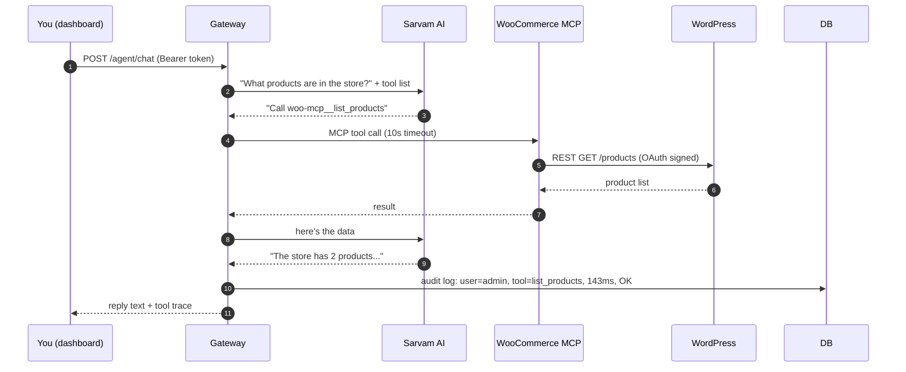

# 🧠 System Design: Urumi MCP Platform

> **One-liner:** A platform that lets an AI talk to your WooCommerce store — safely, through a single "gateway" that acts like a bouncer, traffic cop, and auditor all at once.

---

## 👀 The 30-Second Pitch

Imagine you have three things:
1. **A store** (WooCommerce, where products and orders live)
2. **An AI assistant** (Sarvam AI, that answers questions like "what's in stock?")
3. **Your team** (members who want to use the AI without breaking things)

**Problem:** The AI shouldn't be allowed to talk directly to the store (too dangerous). Each team member shouldn't need their own store password (too risky). Every action should be logged (for safety).

**Our solution:** We built a **Gateway** — a middleman that sits between the AI and the store. It checks who's asking, translates the requests, times them out if they're slow, and writes down everything that happened.

---

## 🗺️ The Big Picture

```mermaid
flowchart LR
    subgraph YOU["👤 You / Your Team"]
        D["🖥️ Dashboard<br/>(React app)"]
        I["🔌 MCP Inspector<br/>(Claude / Cursor)"]
    end

    subgraph GATEWAY["🚪 The Gateway (one pod)"]
        R["REST API<br/>:8000<br/>manages users & servers"]
        M["MCP Switchboard<br/>:8001<br/>routes tool calls"]
        A["AI Agent<br/>loops with Sarvam"]
        DB[("PostgreSQL<br/>users · servers · audit log")]
    end

    subgraph UPSTREAMS["🏪 The Upstream Servers"]
        W["🛍️ WooCommerce MCP<br/>(products, orders)"]
        T["⏰ Time Server<br/>(current time)"]
        C["🧮 Calculator MCP<br/>(math)"]
    end

    subgraph STORE["📦 The Store"]
        WP["WordPress"] --> MAR[(MariaDB)]
    end

    D -->|HTTP| R
    I -->|MCP protocol| M
    A -->|MCP as YOU| M
    R --> DB
    M -->|10s timeout| W & T & C
    W -->|signed REST| WP
    A -.->|HTTPS| S["Sarvam AI"]

    style GATEWAY fill:#1e293b,stroke:#60a5fa
    style UPSTREAMS fill:#0f172a,stroke:#22c55e
```

**Read this top-to-bottom:** You → Gateway → Upstreams → Store. Every arrow is a network call. The Gateway is the single chokepoint where auth, logging, and safety live.

---

## 📚 In Plain English (3 bullets)

- **One entrance, many exits.** Clients talk to one URL (`mcp.127.0.0.1.nip.io`); the Gateway fans out to every registered upstream server.
- **Names don't collide.** If two upstreams both have a `list_products` tool, the Gateway prefixes them (`woo-mcp__list_products`, `fs-mcp__list_products`).
- **Slow servers can't block fast ones.** Every upstream call has a 10-second timeout. If one server is dead, the others still answer.

---

## 🧱 The Four Layers

### Layer 1 — The Store (WordPress + WooCommerce)
Just a normal online shop running in Kubernetes. It has products, orders, and a database. Nothing special — it's the **data source** everything else reads from.

### Layer 2 — WooCommerce MCP Server (we wrote this ourselves)
A small Python program that translates MCP tool calls ("list products") into WooCommerce REST API calls. It holds the store's OAuth keys **and never shares them** with anyone outside the pod.

> **Why REST and not WP-CLI?** REST is just HTTP — easy to call from another pod. WP-CLI would need us to "ssh into" the WordPress pod every time, which is slow and fragile.

### Layer 3 — The Gateway (the heart of the system)
One pod running **two servers**:
- **REST API (port 8000):** the dashboard talks to this to manage users, servers, and audit logs.
- **MCP Switchboard (port 8001):** AI clients and MCP Inspector talk to this to run tools.

Both share the same PostgreSQL database, so an audit log entry written by the MCP side instantly shows up on the dashboard.

### Layer 4 — The Dashboard (React SPA)
A browser UI where admins log in, register upstream servers, see the audit log, and chat with the AI agent. Served by nginx from a static build.

---

## 🚶 How a Tool Call Travels (step by step)

> *"Hey agent, what products are in the store?"* — let's trace what happens.

Six hops. The gateway sees every one of them, times them, and logs them.

---

## 🔑 Three Hard Problems We Solved

### Problem 1: What if two upstreams have tools with the same name?
**Solution: `<server>__<tool>` prefixing.**

We prepend the server name to every tool. So `list_products` from WooCommerce becomes `woo-mcp__list_products`. When a tool is called, we split on `__`, find the right upstream, and route the call.

> **Tradeoff:** Tool names get longer. But this is the *only* scheme that survives aggregation into one flat list, which is what MCP clients expect.

### Problem 2: What if one upstream server dies?
**Solution: timeouts + graceful degradation.**

Every upstream call is wrapped in `asyncio.timeout(10)`. If a server doesn't respond in 10 seconds, we return a clean error to the caller. While listing tools, a failing server is simply skipped — the healthy ones still show up.

> **Tradeoff:** A 10-second timeout is slow for interactive chat. But 10s is generous enough for a real WooCommerce query over OAuth signing, and strict enough that a hung upstream can't freeze the whole gateway.

### Problem 3: How does the audit log know *who* called a tool?
**Solution: identity travels with the session.**

When an admin logs into the dashboard and uses the chat agent, the agent's MCP calls need to be logged as `admin`, not as `agent-service`. We solve this with Python's `contextvars` — a per-async-task identity bag. We set the username at the moment the request hits the gateway, and every downstream operation (including async tool calls) inherits it.

> **Tradeoff:** contextvars only work within a single Python process. That's why we use Kubernetes `sessionAffinity: ClientIP` — a single MCP session always hits the same gateway pod, so the identity bag never gets lost mid-conversation.

---

## ⚖️ Tradeoffs We Made (and why)

| Decision | Why we did it | What we'd change at scale |
|---|---|---|
| **One pod, two servers** (REST + MCP) | Simplest correct MVP — one PVC, one rollout, one image | Split into two Deployments, each with its own Service |
| **PostgreSQL** (not SQLite) | Scales to multiple gateway replicas without database locking | Already production-grade; just add read replicas |
| **Bearer tokens** (not OAuth flow) | Fastest secure auth for an MVP; keys are bcrypt-hashed, revocable | Add MCP-spec OAuth for browser-based SSO |
| **In-memory rate limiting** | Zero extra infrastructure; sliding window per API key | Swap the `dict` for Redis for cluster-wide limits |
| **`nip.io` wildcards** (not `/etc/hosts`) | Zero host-file editing, works on every reviewer's machine | Real domains + cert-manager + Let's Encrypt |
| **Prefix-based tool routing** | Only scheme that survives tool aggregation | Same — this is the right answer |

---

## 🌍 Local vs Production (the same Helm charts, different values)

| Thing | Local (Kind) | Production (k3s / VPS) |
|---|---|---|
| **DNS** | `*.127.0.0.1.nip.io` (magic DNS) | real domain + wildcard `*.yourdomain.com` |
| **TLS** | none (HTTP) | cert-manager + Let's Encrypt auto-certs |
| **Ingress class** | `nginx` | `traefik` (k3s default) or nginx-LB |
| **Storage** | `standard` (hostPath) | cloud CSI (`gp3`, `rook-ceph`, `local-path`) |
| **Images** | `docker build` + `kind load` | push to registry, pull with `IfNotPresent` |
| **Secrets** | K8s Secrets by hand | External Secrets Operator or Vault |
| **DB** | PostgreSQL single-replica | PostgreSQL with replicas + backups |
| **Replicas** | 1 everywhere | gateway/frontend ≥ 2 behind LB |
| **Observability** | `kubectl logs` | Prometheus + Grafana + OpenTelemetry |
| **Rollback** | `helm rollback <name> <rev>` | same — Helm's superpower |

The magic: **the same `helm upgrade --install` command works in both environments**. Only the `values-*.yaml` file changes.

---

## 🛡️ Security, in Plain English

- **Store password?** Stays inside the WooCommerce MCP pod. Even admins don't see it.
- **Admin's API key?** Hashed with bcrypt before storage. If someone steals the database, they can't reverse it.
- **Evil admin registering `http://169.254.169.254/...` to steal cloud credentials?** Blocked by SSRF validation in the REST API.
- **A random pod in the cluster trying to talk directly to WooCommerce?** Blocked by a Kubernetes `NetworkPolicy` — only the gateway pod is whitelisted.
- **A malicious upstream trying to trick the AI with weird tool descriptions?** Descriptions are treated as untrusted data; the agent's system prompt prioritizes user intent.

---

## 🔮 If We Had More Time

- **Multi-tenant store provisioning** (the assignment's bonus): spin up a fresh store from the dashboard, with its own namespace, database, MCP server, and ingress host — all declaratively via Helm.
- **OAuth2 / OIDC login** instead of static bearer tokens, for enterprise SSO.
- **NetworkPolicies everywhere**: gateway can only reach whitelisted upstreams, dashboard can only reach the REST API.
- **OpenTelemetry traces**: see every hop of a tool call in Jaeger.
- **Horizontal pod autoscaling**: gateway scales out under load, rate limiter moves to Redis.
- **GitOps**: ArgoCD watches the repo and auto-deploys on merge.

---

## 📖 Where to Find the Code

| What | Where |
|---|---|
| Gateway REST API | `src/gateway-backend/api.py` |
| Gateway MCP switchboard | `src/gateway-backend/gateway_server.py` |
| AI chat agent | `src/gateway-backend/agent.py` |
| Auth middleware | `src/gateway-backend/auth.py` |
| WooCommerce MCP server | `src/woo-mcp-server/` |
| Time + Calculator upstreams | `src/extras-mcp/` |
| React dashboard | `frontend/` |
| Helm charts | `helm/` (one subfolder per component) |
| Local config | `helm/*/values-local.yaml` |
| Production config | `helm/*/values-prod.yaml` |
| Threat model | `THREAT_MODEL.md` |
| Setup + demo guide | `README.md` |

---

*Built as Round 1 of the AI FDE Internship assignment. The whole system runs on a laptop with Kind and Helm; the same charts deploy to a real k3s VPS with only `values-prod.yaml` changes.*